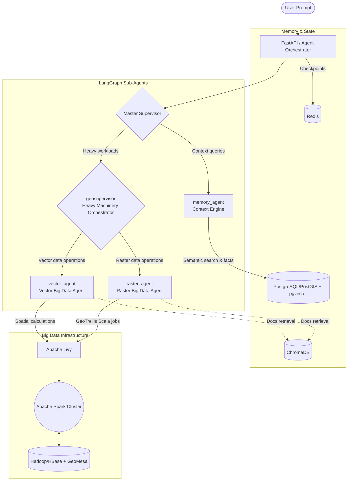

# Multi-Agent Geospatial RAG System

A state-of-the-art intelligent agent system capable of retrieving, ingesting, and analyzing large-scale geospatial data. It combines Large Language Models (LLMs) via Google's Gemini API with LangGraph orchestrations and Big Data geospatial processing via Apache Spark and GeoMesa.

## Architecture & Components

The platform operates using a containerized backend infrastructure while the Agent Orchestrator (FastAPI) runs on the host machine via `uv`.

### Mermaid Architecture Diagram



### 1. Agents, Sub-Agents, and Tools (LangGraph Orchestration)

- **Master Supervisor**: The brain of the operation. It receives user prompts, interprets them using Google's Gemini models, and routes tasks to the `memory_agent` or the `geosupervisor`.
- **`memory_agent` (Context Engine)**: Maintains a database of facts about Regions and Places. Routes contextual questions and deduplicates data.
  - *Tools:* `search_episodic_memory`, `update_episodic_memory`, `delete_episodic_memory`, `add_episodic_memory`.
- **`geosupervisor` (Heavy Machinery Orchestrator)**: A nested supervisor that manages the heavy data processing workflows, routing tasks between the `vector_agent` and `raster_agent`.
  - **`vector_agent`**: Handles heavy spatial workloads and Big Data operations using GeoMesa (e.g., Shapefiles, GeoJSON, intersections).
    - *Tools:* `geomesa_cli_help_tool`, `describe_schema_tool`, `get_feature_names_tool`, `analyze_stats_tool`, `export_spatial_data_tool`, `search_documentation_tool`, `execute_custom_scala_job_tool`.
  - **`raster_agent`**: Handles heavy raster pixel operations using GeoTrellis/Spark (e.g., GeoTIFFs, map algebra, vegetation indices).
    - *Tools:* `get_raster_metadata_tool`, `retrieve_raster_tile_tool`, `calculate_map_algebra_tool`, `search_documentation_tool`, `execute_custom_scala_job_tool`.

### 2. Big Data Infrastructure (Dockerized)

- **Hadoop & HBase (`hbase-master`, `namenode`, `datanode`)**:
  - Serves as the distributed data store for massive geospatial datasets.
  - GeoMesa sits on top of HBase, converting complex geometries (polygons, lines, points) into Space-Filling Curves (Z-order indexing) for lightning-fast spatial queries.
- **Apache Spark & Livy (`spark-master`, `spark-worker`)**:
  - The distributed computing engine. The FastAPI agent acts as a REST client to Apache Livy 0.8.0 (running in the `spark-master`), dispatching spatial SQL and GeoTrellis Scala scripts. This entirely decoupled design prevents Python 3.12/PySpark version mismatches and eliminates JVM startup overhead.
- **PostgreSQL / PostGIS (`postgres`)**:
  - Stores Long-Term Episodic Memory (facts, bounding boxes) and metadata payloads. Uses `pgvector` for semantic search/RAG embeddings.
- **ChromaDB (Local)**:
  - Stores specialized documentation embeddings for API introspection, completely separate from the episodic conversational memory stored in PostGIS.
- **Redis (`redis`)**:
  - Stores LangGraph conversational checkpoints for fast session resumption (`AsyncRedisSaver`).

## Workflow Pipeline
1. **User Request:** "Calculate the vegetation index for the Sfax data I uploaded yesterday."
2. **Context Retrieval:** The LangGraph Supervisor triggers the `memory_agent` (Context Engine) to semantically search PostGIS. It instantly retrieves the fact, the bounding box, and the `metadata_payload` pointing to the exact HBase catalog and layer name.
3. **Heavy Workload Execution:** The Supervisor passes these metadata pointers to the `raster_agent` or `vector_agent` (Heavy Machinery). The agent dispatches a GeoTrellis Scala or PySpark job to Apache Livy, running the distributed computation directly over HBase without moving any data.

## Prerequisites
- **Python 3.12+** (managed via `uv`)
- **Docker & Docker Compose**
- **GeoMesa Spark Runtime Jar:** Required for PySpark to read from/write to GeoMesa natively. Mapped to `/home/ghassen/Bureau/data/geomesa_jars/` and whitelisted in Livy.
- **GeoTrellis Offline Jars:** Pre-downloaded GeoTrellis, Monocle, and HBase dependencies injected into `/spark/jars/` for offline reliability.
- **Apache Livy 0.8.0:** Installed in the `spark-master` container (compiled for Scala 2.12) to serve REST sessions.

## Running the Application
1. Start the infrastructure:
   ```bash
   docker-compose up -d
   ```
2. Start the Agent API:
   ```bash
   uv run python -m app.main
   ```
3. Access the interactive Swagger UI at `http://localhost:8000/docs`.
